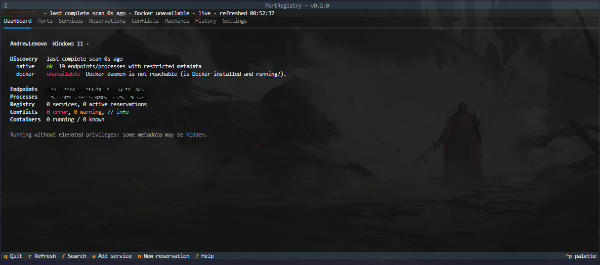
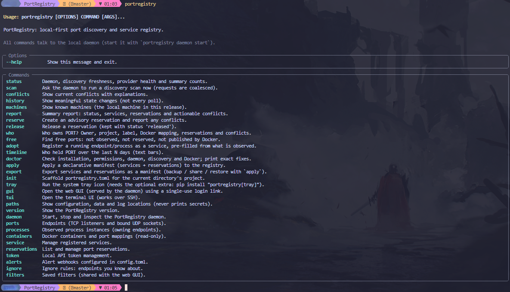

# PortRegistry

PortRegistry is a local-first, cross-platform port discovery and service registry. It:

- finds TCP listeners and bound UDP sockets (IPv4 and IPv6),
- works out which process owns each one,
- keeps a registry of your services and advisory port reservations,
- explains conflicts between what is running and what you declared.

It runs entirely on your machine: there is no cloud account, external database or telemetry.

It has three interfaces, all backed by one local daemon:

- a **Django web GUI** (server-rendered templates with HTMX),
- a **Textual TUI** (works over SSH),
- a **Typer CLI**.

> Status: v0.2.0 (usability release on top of the first implementation pass). See [Known limitations](#known-limitations) for what has and has not been verified.

---

## Architecture

**Architectural rule:** one daemon process owns discovery, scheduling, application logic, event processing and every SQLite write. The GUI, TUI and CLI are clients: none of them scans the system or opens the database.

**Interfaces.**

- **GUI:** dashboard, ports explorer, endpoint and process detail, services, reservations (with a live availability check), conflicts, history, containers, machine and daemon status. Pages update live over SSE.

- **TUI:** dashboard, ports (with search), services, reservations, conflicts, machines, history and settings, plus details and forms.



- **CLI:** every workflow, with table, JSON and CSV output.



```text
 Browser (GUI) ──┐   session + CSRF
 Textual TUI  ───┼── HTTP/JSON + SSE ──► PortRegistry daemon (one process, one uvicorn worker)
 Typer CLI    ───┘   bearer token        │
                                         ├─ Django ASGI: /api/v1/* (DRF) + GUI pages + SSE stream
                                         ├─ Scheduler thread (native scan 10s, Docker 30s, retention hourly)
                                         ├─ Discovery: psutil provider · Docker SDK provider + event listener
                                         ├─ Services layer: reconciliation, registry, reservations, conflicts, history
                                         └─ Django ORM → SQLite (WAL, foreign keys, busy timeout)
```

| Package | Responsibility |
| --- | --- |
| `portregistry.core` | Pure types, address/overlap semantics, identity, event bus, application container (no Django). |
| `portregistry.discovery` | psutil and Docker providers plus normalizers. They collect data only and never touch the database. |
| `portregistry.services` | The only code that writes to the database: reconciliation, registry, reservations, the conflict engine (pure) and its persistence, history, queries. |
| `portregistry.daemon` | Single-instance lock, scheduler, uvicorn server, lifecycle, client-side start/stop control. |
| `portregistry.django_app` | Settings, models, migrations, API (DRF), SSE. |
| `portregistry.gui` | Templates, HTMX partials, login, static assets (htmx vendored for offline use). |
| `portregistry.tui` | Textual app that talks to the API. |
| `portregistry.cli` | Typer commands that talk to the API. |
| `portregistry.client` | Shared sync and async HTTP clients. |

### Key implementation decisions

- **The GUI is served by the daemon.** The browser is the client, and GUI views call the same services layer as the API. No second process touches SQLite.
- **One writer at a time, short transactions.** All writes go through `services.db.write_transaction()`, which combines a process-wide lock with a short `atomic()` block. Discovery data is collected *before* any transaction opens.
- **Polling is the source of truth.** psutil has no portable socket open/close events, so a periodic full scan is the correctness mechanism. Docker events only trigger a (debounced) inventory reconciliation; the periodic Docker inventory is the recovery path.
- **Process identity is machine UUID + PID + creation time.** If the creation time is unreadable, the identity is marked *incomplete* and is never merged with a later process that reuses the PID.
- **Partial or failed scans never imply that something disappeared.**
  - An endpoint is marked gone only when a scan was authoritative for its protocol and port. For per-process fallback scans, it must also have been authoritative for its PID.
  - Unchanged polls only update `last_seen`, so they create no new rows and no history entries.
- **Observed state is kept apart from user intent.** Observed state lives in `ProcessInstance`, `Socket`, `DiscoveryScan` and the Docker models. User intent lives in `Service` and `PortReservation`. History `Event` rows reference entities by id plus a snapshot, so deleting a service or reservation never deletes history.
- **The scheduler starts only inside the daemon lifecycle.** It is never started at import time or from Django `AppConfig.ready()`.
- **SSE events are published only after the transaction commits**, and clients treat them as hints. On (re)connect, clients refetch authoritative state.

---

## What works

**Discovery.** Native discovery uses psutil:

- TCP sockets in LISTEN state and bound UDP sockets (UDP is reported as `BOUND`, because UDP has no LISTEN state).
- IPv4 and IPv6, with wildcard, loopback and specific addresses. IPv4-mapped IPv6 addresses are normalized.
- Several processes sharing one port.
- Per-field process metadata:
  - name, executable, creation time;
  - optionally: command line, username, parent PID and working directory.
- Permission errors (`AccessDenied`), processes that exit mid-scan, and missing PIDs are recorded as partial resolution; they do not make the scan fail.

**Reconciliation and history.** Results are deduplicated. History records only meaningful changes:

- endpoints appearing or disappearing, and endpoint owner changes;
- processes appearing or disappearing;
- containers appearing, disappearing or changing status;
- service and reservation create, update, release and delete;
- conflicts detected and resolved;
- scan health changes and Docker availability changes;
- the machine going online or offline.

**Docker (optional).** Read-only discovery of:

- container inventory: id, name, image, status, labels, networks;
- internal ports versus host-published mappings, with protocol and host IP.

It also includes an event listener that reconnects with backoff. When Docker is unavailable, the rest of PortRegistry carries on normally.

**Registry.**

- **Services:** create, read, update and delete, with name, description, category, expected executable (a name, a path, or `docker:NAME`), expected working directory, documentation URL and notes.
- **Reservations:**
  - fields: port, protocol, bind address (`*`, `0.0.0.0`, `::` or an IP literal), service and description;
  - actions: create, edit, release, reactivate, delete, and a dry-run check.
  - Reservations are advisory and never lock a port at OS level.

**Conflict engine.** It reports occupied reservations, overlapping or duplicate reservations, unregistered listeners, service mismatches, missing expected services and incomplete discovery. Each finding is marked definite or potential and comes with an explanation and evidence.

**API.** Served under `/api/v1/`:

- health (public), status, machines, ports, processes, containers, services, reservations, conflicts, discovery scan requests (coalesced) and scan history, history, and an SSE stream.
- Errors use a consistent JSON shape, and lists use limit/offset pagination.

**Daemon.**

- Single-instance OS lock, with stale state-file detection.
- Initial discovery, then periodic reconciliation.
- Detached start, foreground run, and graceful shutdown (SIGINT/SIGTERM or the API).
- Restarts preserve all data.

---

## Installation

You need Python 3.12 or newer. From the repository root:

**Windows (PowerShell):**

```powershell
py -3.12 -m venv .venv
.\.venv\Scripts\Activate.ps1
python -m pip install --upgrade pip
pip install -e ".[docker]"        # or: pip install -e .   (without Docker support)
```

**Linux / macOS:**

```bash
python3.12 -m venv .venv
source .venv/bin/activate
python -m pip install --upgrade pip
pip install -e ".[docker]"        # or: pip install -e .
```

**With pipx** (isolated, puts `portregistry` on your PATH):

```bash
pipx install ".[docker]"          # from the repository root
pipx run --spec . portregistry version
```

**Standalone bundles:** CI builds one-folder PyInstaller bundles for Windows, Linux and macOS (`portregistry-<OS>` artifacts of the `binaries` job). Unzip and run `portregistry` (or `portregistry.exe`); no Python install is needed. To build one locally:

```bash
pip install -e ".[docker,binary]"     # add ,tray on Windows/macOS for the tray icon
pyinstaller --noconfirm --clean packaging/pyinstaller/portregistry.spec
dist/portregistry/portregistry version
```

Optional extras: `docker` (Docker discovery), `tray` (system tray icon: pystray + Pillow), `binary` (PyInstaller).

For development, which adds pytest, pytest-django, ruff, mypy and build:

```bash
pip install -e ".[docker,dev]"
```

Check the installation:

```bash
portregistry version
portregistry --help
```

### Optional Docker dependency

Docker support is the `docker` extra (`pip install "portregistry[docker]"`). Without it, PortRegistry runs normally and reports Docker as *unavailable* ("Docker SDK for Python is not installed"). You can also turn Docker discovery off entirely with `docker_enabled = false` in the config file.

---

## Running the daemon

```bash
portregistry daemon start        # detached; waits until it is healthy (initial scan runs first)
portregistry daemon status       # running? healthy? pid, URL
portregistry daemon logs -n 100  # recent log lines (add -f to follow)
portregistry daemon restart
portregistry daemon stop         # graceful: finishes the current scan, flushes writes, releases the lock
```

- **Foreground (development):** run `portregistry daemon run` and stop it with Ctrl+C.
- **Different port:** use `portregistry daemon start --port 9876`, or set `PORTREGISTRY_PORT`.
- **Second daemon:** starting a second daemon is refused. A crashed daemon never leaves a stale lock, because the OS releases it.
- **Forced stop:** `daemon stop --force` terminates the recorded process only after verifying its PID and creation time. Use it only if a graceful stop hangs.

By default the daemon listens on **`127.0.0.1:8765`** with the API under **`/api/v1/`**. Binding to a non-loopback address needs both `host` and `allow_remote = true` in the config, and logs a security warning.

---

## Web GUI

```bash
portregistry gui                 # starts the daemon if needed, opens a single-use login link
portregistry gui --no-browser    # just print the link (e.g. to open it elsewhere)
```

The link is valid for 60 seconds and can be used once. It creates a browser session that lasts 7 days, after which you can browse to `http://127.0.0.1:8765/` directly. Alternatively, open `http://127.0.0.1:8765/login/` and paste the API token from the `token` file (see `portregistry paths`).

Browser changes use Django sessions with CSRF protection. Pages update live over Server-Sent Events. The top bar shows:

- scan freshness, with stale data called out;
- limited visibility (permission restrictions);
- Docker status;
- the live/disconnected state of the SSE connection.

All assets are served locally, so the GUI works offline.

## Terminal UI

```bash
portregistry tui
```

| Key | Action |
|---|---|
| `1`–`8` / Tab | Switch tab or move focus |
| `/` | Search ports |
| `r` | Refresh |
| Enter | Show details for the selected row |
| Esc | Back / close |
| `a` | Add a service |
| `n` | New reservation (pre-filled from the selected port) |
| `x` | Release the selected reservation |
| `i` | Show or hide info-level conflicts |
| `?` | Help |
| `q` | Quit |

The TUI uses only the daemon API and is designed for SSH sessions. If the live connection drops, it keeps showing the last data with a warning and reconnects on its own.

---

## CLI examples

```bash
portregistry status                              # daemon, freshness, providers, counts
portregistry scan                                # scan now and wait (requests are coalesced)
portregistry scan --protocol tcp --port 8080     # targeted reconciliation
portregistry ports --port 8080                   # who owns port 8080?
portregistry ports --search node --protocol tcp
portregistry ports -o json                       # JSON; -o csv for CSV
portregistry ports show 42                       # one endpoint with process/reservation/conflict context
portregistry processes --search python
portregistry containers

portregistry service add webapp --exe node --cwd /srv/webapp --category web -d "Frontend"
portregistry service list
portregistry service show webapp
portregistry service edit webapp --exe /usr/bin/node
portregistry service delete webapp --yes         # reservations are kept (unlinked)

portregistry reserve 3000 --service webapp -d "dev server"
portregistry reserve 5353 --protocol udp --address 0.0.0.0
portregistry reserve 8080 --dry-run              # check only: occupancy + overlaps
portregistry reservations                        # --status released|all
portregistry reservations show 1
portregistry reservations edit 1 --address 127.0.0.1
portregistry release 1

portregistry conflicts                           # warnings and errors, with explanations
portregistry conflicts --all                     # include info (e.g. unregistered listeners)
portregistry history -n 50 --type endpoint
portregistry machines
portregistry report                              # markdown summary (or -o json)
portregistry paths                               # where config/data/logs live
```

Exit codes:

| Code | Meaning |
|---|---|
| 0 | Success |
| 1 | API or validation error |
| 2 | Configuration error |
| 3 | Daemon not running |
| 4 | Daemon already running |

---

## Everyday tools (v0.2)

```bash
portregistry who 8080                  # owner, project, label, Docker mapping, reservations, conflicts
portregistry free                      # 5 free TCP ports in 3000-9999 (not observed, not reserved, not Docker-published)
portregistry free --range 5000-5999 --protocol udp --count 3
portregistry free --reserve --service webapp   # find and reserve in one step
portregistry adopt 3000                # register the process on port 3000 as a service (pre-filled, asks to confirm)
portregistry adopt 3000 --name shop --yes
portregistry timeline 8080 --days 7    # who held port 8080 over the last week (text bars)
portregistry ports --watch             # live table: new endpoints green, closed ones red
portregistry ports --group project     # or --group process
```

- **Labels:** about 150 well-known and common development ports get a label (5432 PostgreSQL, 5173 Vite, 9229 Node inspector...). Labels are hints; they never decide ownership.
- **Projects:** a process's working directory is walked up (stat only, at most 12 levels) to find a project root (`.git`, `pyproject.toml`, `package.json`, `compose.yaml`...). Docker containers use their Compose project label.
- **Adopt** pre-fills name (project, Compose service or process), expected executable, working directory and category, and reserves the process's endpoints. In the GUI: **Register as service** on any port or process page. In the TUI: `s` on the Ports tab.
- **Free-port checks** also do a quick test bind on this machine by default, which catches sockets discovery could not see. Results are advisory; reserve a port to record intent. The OS ephemeral range and ports below 1024 are skipped unless you include them.
- **GUI:** "Suggest free port" in the reservation form, a Timeline page, ports grouping, and saved filters on Ports and History. **TUI:** a free-port button in the reservation form.

## Reducing noise

The Conflicts page and History used to fill up with short-lived client sockets. v0.2 separates real changes from churn:

- **Ephemeral UDP** sockets (the OS dynamic range: 49152-65535 on Windows/macOS, `ip_local_port_range` on Linux) are not reported as unregistered listeners, and their history events are marked as *noise*.
- **Flapping:** an endpoint or process that disappears within `flap_window_seconds` (120 s) of appearing has both events marked as noise.
- **Ignore rules** ("known" endpoints) match by process name glob, executable glob, protocol, port range and address. Each rule can hide unregistered-listener findings, history churn, or both. **Conflicts that involve a reservation are never hidden**, because a reservation is explicit intent.
  - GUI: **Mark as known** on a port or process page; manage rules under **Ignore rules**.
  - CLI: `portregistry ignore add --name chrome --process "chrome*" --protocol udp`, `portregistry ignore known <endpoint-id>`, `portregistry ignore list|toggle|remove`.
  - TUI: `k` on the Ports tab.
- Noise is **hidden, not deleted**: History shows "N short-lived events hidden" with a toggle (`history --noise` in the CLI, `z` in the TUI). Noise events are purged after `noise_retention_days` (3).

## Manifests: share and restore port assignments

Commit a `portregistry.toml` to a repository so a team agrees on ports:

```toml
version = 1

[[service]]
name = "web"
expected_executable = "node"
expected_working_directory = "."      # relative to this file

  [[service.port]]
  port = 3000                         # protocol defaults to tcp, address to *

[[reservation]]                       # reservations without a service
port = 5432
description = "Shared Postgres"
```

```bash
portregistry init                       # scaffold from this directory's project (registered services + running processes)
portregistry apply --dry-run            # show creates/updates/unchanged
portregistry apply                      # apply (one transaction; validated first)
portregistry apply --prune              # also release/delete items this manifest created earlier but no longer lists
portregistry export -f backup.toml      # full registry backup; restore with `portregistry apply backup.toml`
portregistry export --format json --service web
```

Services match by name and reservations by (service, protocol, port, address). Keys omitted from the manifest are left unchanged. `--prune` only touches items that were created or claimed by the same manifest file; nothing else is ever pruned.

## Alerts and notifications

- **Webhooks** (opt-in; nothing is sent unless configured). Add to `config.toml`, then restart the daemon:

  ```toml
  [[alerts.webhook]]
  url = "http://127.0.0.1:9000/portregistry"
  min_severity = "warning"            # info | warning | error
  events = ["conflict.detected", "conflict.resolved", "docker.unavailable", "scan.failed"]
  secret = "shared-secret"            # optional: X-PortRegistry-Signature: sha256=<HMAC of the body>
  ```

  Delivery runs on a background thread with 3 retries and never blocks discovery. Test with `portregistry alerts test`; see counters with `portregistry alerts status`. Payload: `{"source", "version", "event", "severity", "timestamp", "machine": {"hostname", "uuid"}, "data": {...}}`.
- **Browser notifications:** click **Desktop alerts** in the GUI sidebar (per-browser opt-in, uses the Notification API on live SSE events).
- **Tray notifications:** see below.
- **Scripts and CI:** `portregistry conflicts --fail-on warning` exits with code **5** if any warning or error exists.

## Start at login, tray icon and doctor

```bash
portregistry daemon install --dry-run   # show exactly what would be written
portregistry daemon install             # start the daemon at login (add --tray for the tray icon)
portregistry daemon autostart           # status
portregistry daemon uninstall
```

| OS | Mechanism (per user, no admin rights) |
|---|---|
| Windows | `HKCU\Software\Microsoft\Windows\CurrentVersion\Run` value running `pythonw -m portregistry daemon run --quiet` (no console window) |
| Linux | systemd user unit `~/.config/systemd/user/portregistry.service` (`systemctl --user enable --now`); XDG autostart `.desktop` file if systemd is unavailable |
| macOS | LaunchAgent `~/Library/LaunchAgents/io.portregistry.daemon.plist` (`launchctl bootstrap gui/<uid>`) |

A `PORTREGISTRY_HOME` set when you run `install` is carried into the autostart entry.

**Tray icon** (`pip install "portregistry[tray]"`, then `portregistry tray`): a coloured dot (green ok, yellow warnings or stale data, red errors, grey daemon down) with a menu to open the GUI, see conflicts, scan now, start/stop the daemon, and toggle notifications for new conflicts.

**Doctor:** `portregistry doctor` checks Python, config, data-dir permissions, token-file permissions, daemon reachability (or whether its port is taken), database integrity and WAL mode, disk space, scan health and freshness, visibility/elevation, Docker, scheduler, webhooks, autostart and the tray extra. Each check prints an exact fix. It exits 1 if anything fails (`-o json` for scripts).

**Token rotation:** `portregistry token rotate` replaces the local API token (the old one stops working immediately) and logs out browser sessions unless `--keep-sessions`. The new token is written to the token file and never printed.

**Visibility hints:** the GUI machine page, the "Limited visibility" badge and `doctor` explain how to get fuller visibility on your OS (for example, start the daemon from an Administrator terminal on Windows). PortRegistry still never elevates itself.

---

## Data and configuration locations

Run `portregistry paths` to see the exact paths. The defaults come from platformdirs:

| OS | Config, token and data | Logs |
|---|---|---|
| Windows | `%LOCALAPPDATA%\portregistry\` | `%LOCALAPPDATA%\portregistry\Logs\` |
| Linux | `~/.config/portregistry/` (config, token), `~/.local/share/portregistry/` (data) | `~/.local/state/portregistry/log/` |
| macOS | `~/Library/Application Support/portregistry/` | `~/Library/Logs/portregistry/` |

Files:

| File | Contents |
|---|---|
| `config.toml` | Commented configuration, written on first start. Restart the daemon after editing it. |
| `token` | Local API token for the CLI and TUI. On POSIX it is mode 0600; on Windows it is protected by your user profile's permissions. It is never logged. |
| `portregistry.sqlite3` | The database (WAL mode). |
| `machine_id` | The persistent machine UUID: random, with no hardware identifiers. |
| `secret_key` | Django secret key. |
| `daemon.lock` | Single-instance lock file. |
| `daemon.json` | Daemon state file. |
| `daemon.log` | Rotating log. |
| `daemon-bootstrap.log` | Startup output of a detached daemon. |

Set `PORTREGISTRY_HOME=/some/dir` to keep everything under one directory, for isolated demos or several instances.

Configuration keys and their defaults:

| Section | Key | Default |
|---|---|---|
| `[daemon]` | `host` | `127.0.0.1` |
| `[daemon]` | `port` | `8765` |
| `[daemon]` | `allow_remote` | `false` |
| `[discovery]` | `native_interval` | `10` |
| `[discovery]` | `docker_enabled` | `true` |
| `[discovery]` | `docker_interval` | `30` |
| `[discovery]` | `collect_cmdline` | `true` |
| `[discovery]` | `collect_username` | `true` |
| `[discovery]` | `collect_cwd` | `true` |
| `[discovery]` | `stale_after_factor` | `3` |
| `[history]` | `retention_days` | `30` |
| `[noise]` | `ephemeral_udp` | `true` |
| `[noise]` | `flap_window_seconds` | `120` (0 disables) |
| `[noise]` | `noise_retention_days` | `3` |
| `[[alerts.webhook]]` | `url`, `min_severity`, `events`, `secret` | none (alerts off) |
| `[logging]` | `level` | `INFO` |

`retention_days` applies to events and to inactive observed sockets, processes, containers and scans. Services and reservations are never deleted by retention.

---

## Permissions and visibility

PortRegistry **never elevates privileges** (no sudo, no UAC). It never reads process environment variables and never executes discovered command lines.

How much it can see depends on the OS and your privileges, and it reports this as *limited visibility*:

- **Windows:** socket owners (PIDs) are visible without admin rights. The executable path, command line and user of system or service processes are often access-denied; these show as "limited" metadata.
- **Linux:** every socket is listed, but other users' socket owners need root (or capabilities). Those endpoints appear with an *unknown owner*. For a diagnostic cross-check, run `ss -lntup`.
- **macOS:** without root, the system-wide socket table is denied. PortRegistry falls back to listing each process's sockets, marks the scan **partial**, and sees only your own processes. For a diagnostic cross-check, run `lsof -nP -iTCP -sTCP:LISTEN`.

Command lines can contain secrets passed as arguments. They are stored only in the local database, are shown escaped, and can be turned off with `collect_cmdline = false`.

## Docker: setup and security caveats

- Install the extra (`pip install -e ".[docker]"`) and make sure the Docker daemon is running and reachable through `DOCKER_HOST` or the default socket or pipe.
- **Access to the Docker socket is highly privileged.** On Linux, membership of the `docker` group is equivalent to root. PortRegistry uses only read operations (ping, version, container list/inspect, events). It never runs commands in containers, never changes container lifecycle, and never exposes the Docker socket through its own API.
- Internal container ports, host-published mappings and host-visible sockets are three separate things:
  - On Linux, a published port also appears as a host socket owned by `docker-proxy`.
  - On Docker Desktop (Windows/macOS), the host socket is owned by `com.docker.backend` or `wslrelay`, and container processes are not host processes.
- If Docker becomes unreachable, containers keep their last known state and are flagged as possibly out of date. They are not marked as removed.

---

## Conflict model

Overlap rules for the same protocol and port:

| Case | Result |
|---|---|
| `*` (any address) versus anything | Definite overlap |
| Same address | Definite overlap |
| IPv4 wildcard `0.0.0.0` versus a specific IPv4 address (e.g. `127.0.0.1`) | Definite overlap |
| IPv6 wildcard `::` versus any IPv4 address | **Potential** overlap: dual-stack behaviour depends on `IPV6_V6ONLY` |
| TCP versus UDP on the same port | Never a conflict on their own |

| Type | Meaning |
|---|---|
| `occupied_reservation` | A reserved endpoint is bound, and the owner is not tied to a service or cannot be verified. |
| `service_mismatch` | The owner does not match the service's expected executable, working directory or `docker:NAME`. |
| `overlapping_reservation` | Two active reservations overlap; exact duplicates are titled "Duplicate". |
| `unregistered_listener` | An endpoint that no reservation covers (info; hidden by default). |
| `missing_expected_service` | No listener for a service's reservation. *Definite* only after a fresh, complete scan; otherwise *potential*. |
| `incomplete_discovery` | The scan failed, was partial or is stale; owners are unresolved; or Docker is unavailable. |

---

## End-to-end demo

1. Install and start the daemon:

   ```bash
   pip install -e ".[docker,dev]"
   portregistry daemon start
   portregistry status
   ```

2. In another terminal, open a test TCP listener and a UDP socket:

   ```bash
   python -c "import socket,time; t=socket.socket(); t.bind(('127.0.0.1',18080)); t.listen(); u=socket.socket(type=socket.SOCK_DGRAM); u.bind(('0.0.0.0',18081)); time.sleep(600)"
   ```

3. Discover them:

   ```bash
   portregistry scan
   portregistry ports --search 1808   # both appear with the owning python process + PID
   ```

4. Register a service and reserve the occupied port:

   ```bash
   portregistry service add demo --exe nginx
   portregistry reserve 18080 --service demo
   # -> error (definite) service_mismatch: expected 'nginx', observed python
   portregistry reserve 18080 --address 127.0.0.1    # -> overlapping_reservation with #1
   portregistry reserve 18080 --protocol udp         # -> no conflict: TCP and UDP are independent
   portregistry conflicts
   ```

5. Open the GUI and the TUI. Both show the same machine, endpoints, reservations and conflicts:

   ```bash
   portregistry gui
   portregistry tui
   ```

6. Stop the test process (Ctrl+C), wait about 10 seconds or run `portregistry scan`, then check the history:

   ```bash
   portregistry history -n 10   # endpoint.disappeared / process.disappeared, conflict changes
   ```

7. Restart and confirm that the data survives:

   ```bash
   portregistry daemon restart
   portregistry service list
   portregistry reservations --status all
   portregistry machines        # same machine UUID
   ```

8. Run the tests:

   ```bash
   pytest
   ```

9. If Docker is available:

   ```bash
   docker run -d --name demo-web -p 18090:80 nginx:alpine
   portregistry containers
   portregistry ports --port 18090   # host socket + Docker correlation
   docker rm -f demo-web             # within seconds: container.disappeared in history
   ```

---

## Known limitations

- **Platform coverage:**
  - Developed and verified on **Windows 11** only: unit, integration, API, GUI, TUI and CLI tests, plus live daemon runs.
  - Linux and macOS behaviour follows the documented psutil semantics and runs in CI, but has **not been run interactively**.
  - Full platform parity is not claimed.
- **Live Docker discovery** was **not verified** on the development machine, which has no Docker or WSL. What was covered:
  - fake-client unit tests and the "Docker unavailable" path.
  - A `docker_live` test suite (`tests/docker/test_docker_live.py`) runs in CI on Ubuntu and is intended for manual cross-checking on a Docker host:

    ```bash
    PORTREGISTRY_REQUIRE_DOCKER=1 pytest -m docker_live
    ```

  - GitHub's Windows and macOS runners cannot run Linux containers, so live Docker coverage there relies on that manual check.
- **No real-time native socket events.** Changes appear within one scan interval (10 s by default), or straight away after `portregistry scan`.
- **No replay of missed SSE events.** Clients reconnect and refetch state instead.
- **Noise heuristics.** Ephemeral-range UDP and flapping endpoints are treated as noise; a real UDP service bound inside the ephemeral range is hidden from unregistered-listener findings until you reserve it (reservations are never hidden). Set `ephemeral_udp = false` to disable.
- **Not run live on this machine (by request):** `daemon install` was exercised only with `--dry-run` and unit tests through fake backends, and the tray icon only through a fake backend (icon rendering verified with real Pillow; the tray was not launched). Linux/macOS autostart backends are unit-tested with temp directories and a fake command runner.
- **Binaries:** the Windows bundle was built and smoke-tested locally; Linux and macOS bundles are built and smoke-tested only in CI.
- **Timeline precision:** intervals are reconstructed from scan observations, so open/close times have scan-interval precision.
- **Process tracking scope.** Processes are tracked only while they own endpoints. "Process disappeared" means "no longer owns any observed endpoint", not necessarily that the process exited.
- **Deferred to later releases:**
  - remote machines and agents;
  - system-wide OS services (Windows Service, root systemd units); per-user login autostart is available;
  - service dependency graphs;
  - a separate `DockerNetwork` table (network data is stored as JSON on the container);
  - native fallbacks (Windows IP Helper, `/proc`).
- **No LICENSE file yet.** The licence is for the project owner to choose.

---

## Development

```bash
pip install -e ".[docker,dev]"
pytest                          # full suite (includes a real daemon-lifecycle test)
pytest -m "not slow"            # skip daemon subprocess tests
pytest -m docker_live           # live Docker tests (skipped if Docker is unreachable)
ruff check src tests
ruff format --check src tests
mypy                            # core, discovery, config, paths, client, conflict engine, daemon parts, tray
python -m build                 # sdist + wheel
pyinstaller --noconfirm --clean packaging/pyinstaller/portregistry.spec   # needs the [binary] extra
```

Django management commands, for example after changing models:

```bash
python -m django makemigrations portregistry --settings=portregistry.django_app.settings
```

CI is defined in `.github/workflows/ci.yml`. It runs lint and type checks, tests on Ubuntu, Windows and macOS with Python 3.12 and 3.13, a Docker-required live job on Ubuntu, a package build with wheel and pipx smoke tests, and PyInstaller bundles for all three OSes (each smoke-tested by starting and stopping the daemon).
